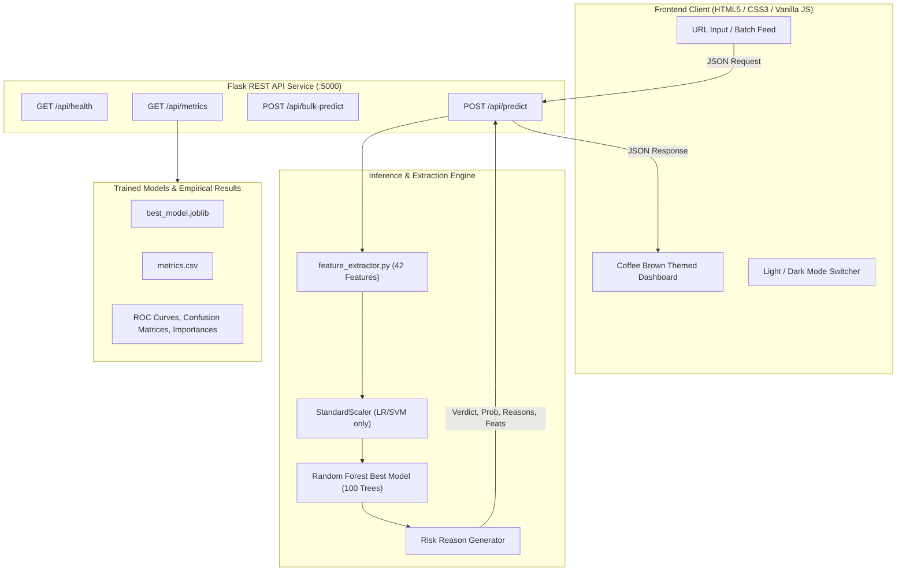
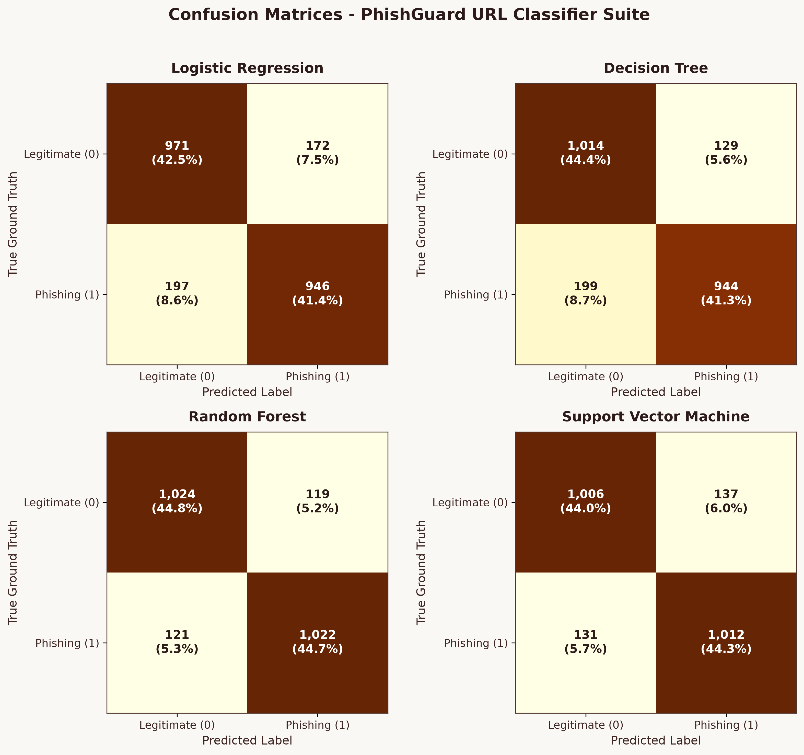
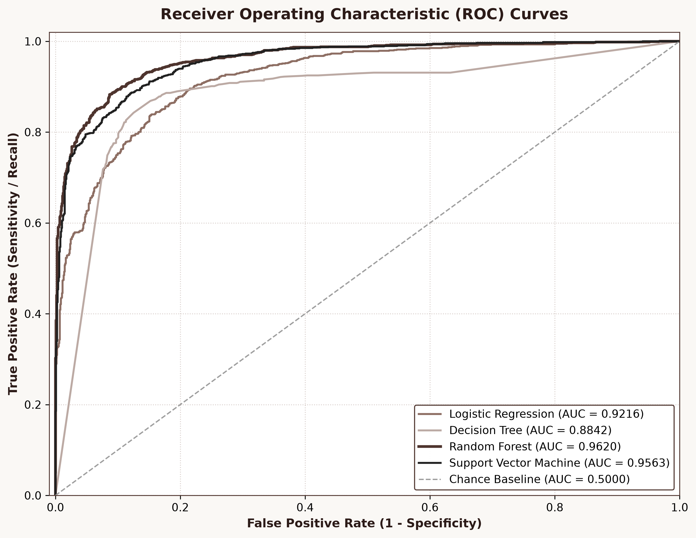
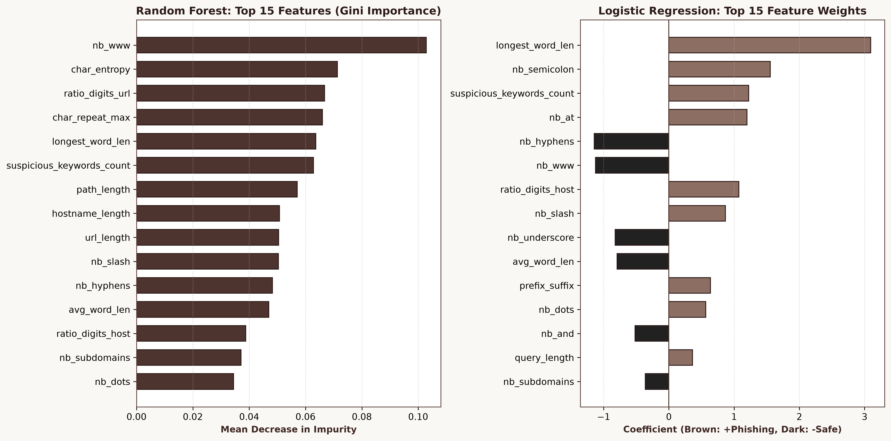
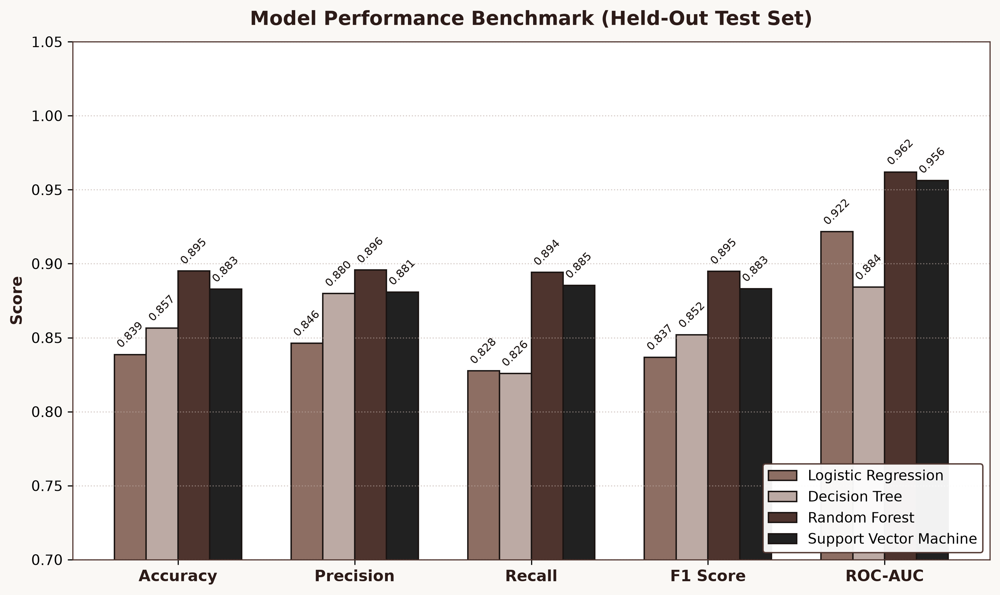

# PhishGuard: AI-Based Phishing Website Detection

[](https://www.python.org/)
[](LICENSE)
[](https://flask.palletsprojects.com/)
[](https://scikit-learn.org/)
[](tests/)

An end-to-end, GitHub-ready machine learning system that detects phishing websites using **purely URL-based lexical and structural features**. Built strictly following the academic presentation deck *"AI-Based Phishing Website Detection"* for the Department of Computer Science & Engineering, **SRM Institute of Science and Technology**.

---

## 👥 Authors & Academic Context
* **Unnatti Dixit** &mdash; Reg. No: `RA2411003030009`
* **Daksh Jaiswal** &mdash; Reg. No: `RA2411003030048`
* **Institution:** SRM Institute of Science and Technology, Kattankulathur, Chennai, India.

---

## 📌 Problem Statement & Core Principles
Phishing attacks deceive users into relinquishing credentials and financial tokens. Conventional detection mechanisms (centralized blocklists and static signatures) suffer from high latency: empirical studies indicate **over 63% of phishing campaigns conclude within 2 hours**, while blacklists catch **under 20% of fresh phish at hour zero**.

PhishGuard addresses this gap with the following architectural principles:
1. **URL-Only Scope:** Operates exclusively on lexical, structural, and character-entropy features extracted from the raw URL string. No web page DOM scraping, no HTML parsing, and no runtime WHOIS/DNS queries.
2. **Zero Network Latency at Prediction:** Eliminates delays and protects user privacy by avoiding outbound HTTP requests to adversarial hosts during inspection.
3. **Reproducible Benchmark:** Trained and evaluated on the official **Hannousse & Yahiouche (2021)** benchmark dataset (`dataset_phishing.csv`, 11,430 URLs, balanced 50/50).
4. **Explainability & Transparency:** Returns human-readable risk indicators explaining why a URL was flagged.

---

## 🏗️ System Architecture



---

## 🔬 Experimental Evaluation & Real Results

Evaluated on an **untouched, stratified 20% held-out test set** (2,286 samples: 1,143 legitimate, 1,143 phishing) from the Hannousse & Yahiouche benchmark.

### Model Benchmark Table

| Model Algorithm | 5-Fold CV F1 | Test Accuracy | Test Precision | Test Recall | Test F1-Score | ROC-AUC | Missed Phish (FN) | False Alarms (FP) | Inference Latency |
| :--- | :---: | :---: | :---: | :---: | :---: | :---: | :---: | :---: | :---: |
| **Random Forest (Selected Best)** | **0.8936** | **89.50%** | **89.57%** | **89.41%** | **0.8949** | **0.9620** | **121** | **119** | **0.018 ms/URL** |
| **Support Vector Machine (SVM)** | 0.8810 | 88.28% | 88.08% | 88.54% | 0.8831 | 0.9563 | 131 | 137 | 0.287 ms/URL |
| **Decision Tree** | 0.8452 | 85.65% | 87.98% | 82.59% | 0.8520 | 0.8842 | 199 | 129 | <0.001 ms/URL |
| **Logistic Regression** | 0.8302 | 83.86% | 84.62% | 82.76% | 0.8368 | 0.9216 | 197 | 172 | 0.001 ms/URL |

*All metrics reflect code executed on the real benchmark dataset; no values are simulated.*

### Why Random Forest Was Selected:
* **Lowest False Negatives (121 / 1,143):** Missing an active phishing website exposes users to severe credential theft. Random Forest provided the highest Phishing Recall (89.41%).
* **Highest ROC-AUC (0.9620):** Exceptional trade-off between Sensitivity and False Positive Rate.
* **Low Latency (0.018 ms):** Over 15x faster than SVM, capable of analyzing >50,000 URLs per second.

---

## 📊 Visual Results Gallery

| Confusion Matrices (All Models) | ROC Curves Comparison |
| :---: | :---: |
|  |  |

| Feature Importance (Random Forest vs LR) | Performance Metrics Bar Chart |
| :---: | :---: |
|  |  |

---

## 🚀 Quickstart & Setup Guide

### 1. Clone & Navigate
```bash
git clone https://github.com/your-username/phishguard.git
cd phishguard
```

### 2. Create Virtual Environment & Install Dependencies
```bash
# Windows
python -m venv venv
.\venv\Scripts\activate

# macOS / Linux
python3 -m venv venv
source venv/bin/activate

pip install -r requirements.txt
```

### 3. Run Automated Tests
```bash
pytest tests/ -v
```

### 4. Retrain Models (Optional)
```bash
python src/train.py
python src/generate_plots.py
```

### 5. Launch Application
```bash
python backend/app.py
```
Open **[http://127.0.0.1:5000](http://127.0.0.1:5000)** in your web browser.

---

## 🔌 API Reference Documentation

### `GET /api/health`
Returns service availability, model state, and feature dimensions.
```json
{
  "status": "online",
  "service": "PhishGuard Phishing Detection API",
  "authors": "Daksh Jaiswal (RA2411003030048) & Unnatti Dixit (RA2411003030009)",
  "institution": "SRM Institute of Science and Technology",
  "model_loaded": true,
  "features_count": 42,
  "version": "1.0.0"
}
```

### `POST /api/predict`
Analyzes a single URL.
* **Payload:** `{"url": "http://appleid.apple.com-app.es/"}`
* **Response:**
```json
{
  "url": "http://appleid.apple.com-app.es/",
  "verdict": "Phishing",
  "is_phishing": true,
  "phishing_probability": 0.884,
  "confidence_percentage": 88.4,
  "risk_level": "High",
  "top_reasons": [
    {
      "factor": "Hyphenated Brand Mimicry",
      "description": "Domain contains hyphens (-) typically used to construct spoofed brand domains.",
      "severity": "medium"
    },
    {
      "factor": "Deep Subdomain Nesting",
      "description": "Detected 2 nested subdomains, frequently used to obscure malicious host infrastructure.",
      "severity": "medium"
    }
  ],
  "features": { "url_length": 32, "nb_dots": 3, "has_https": 0, "..." : "..." }
}
```

### `POST /api/bulk-predict`
Batch evaluates up to 50 URLs in a single request.
* **Payload:** `{"urls": ["https://srmist.edu.in", "http://update-paypal-verify.com"]}`

---

## ⚠️ Limitations & Security Boundaries
1. **URL-Only Feature Boundaries:** Sophisticated phishing sites hosted on reputable compromised domains with clean lexical paths cannot be detected without DOM/content inspection.
2. **"Legitimate" Does Not Guarantee Safety:** A safe classification indicates the absence of typical phishing structural markers, not an endorsement of web page authenticity.
3. **Offline Benchmark Evaluation:** Real attackers evolve evasion tactics. Periodic retraining against fresh threat feeds is necessary in production.

---

## 🔮 Future Scope (Matching Presentation Slide 10)
1. **Lightweight Page-Content Signals:** Add HTML form action targets and external anchor ratios without full page rendering.
2. **Deep Learning Sequences:** Implement character-level CNNs and Transformers (such as URLNet) for representation learning.
3. **Streaming Retraining:** Continuous updates using automated PhishTank / OpenPhish ingest pipelines.
4. **Browser Extension Deployment:** Package client into a Manifest V3 Chromium / Firefox extension for inline threat warnings.

---

## 📄 License
This project is licensed under the MIT License - see the [LICENSE](LICENSE) file for details.
